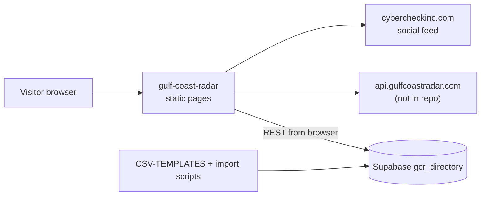

# gulf-coast-radar

The original all-in-one "Gulf Coast Radar" website: a static directory of Orange Beach, Gulf Shores and Perdido Key businesses, with admin pages and import scripts.

## What it is

A large pile of plain HTML, CSS and JavaScript that grew over several months: a directory of restaurants,
bars, coffee shops and things to do, with happy hours, specials, events, a social feed, an AI helper and an
admin dashboard. It also carries import data (CSVs), a small SaaS API shell, and a copied GCR API route file.
Its backend is not in this repo. It has since been superseded by `Front-end-gcr-` plus an API.

## How it works

- Root has 34 HTML pages (`index.html`, `restaurants.html`, `happy-hours.html`, `events.html`, `specials.html`,
  `feed.html`, `profile.html`, `dashboard.html`, `admin-dashboard.html`, `ar-hunt.html` and more), `js/` (144 files),
  `css/` (70 files). No root `package.json`.
- `js/config.js` sets API bases: in development the GCR API is `http://localhost:3002/api/gcr`, the CyberCheck API
  is `http://localhost:3000` and the social feed API is `http://localhost:3001/api`. In production they are
  `https://api.gulfcoastradar.com/api/gcr`, `https://cybercheckinc.com` and `https://api.gulfcoastradar.com/social`.
- `js/business-loader.js` and `js/gcr-supabase-loader.js` read the `gcr_directory` table from Supabase directly in the
  browser. Other tables named in the code: `gcr_reservations`, `gcr_leads`, `gcr_analytics`, `gcr_listed`, `gcr_user_session`.
- `data/data.js` is a near-empty placeholder; `js/fallback-data.js` holds a small fallback set.
- Import data: `CSV-TEMPLATES/` (business profile, hours, happy hour, menu and item templates) and
  `cobalt_master_all_data_with_events.csv`; scripts `import-cobalt-complete.js`, `import-cobalt-fixed.js`,
  `upload-to-supabase.js`, `test-csv-import.js` and several `check_*.py`.
- `saas-api/` (Express: `saas-server.js`, routes `saas-auth`, `saas-apps`, `saas-user`, `db/saas-schema.sql`) and
  `saas-dashboard/` are a small separate multi-app SaaS shell.
- `CYBERCHECK-MODULAR-PLATFORM/api-routes/gcr.js` is a copy of a GCR API route file. It requires `../gcr-db` and
  `../db`, which are not in this repo, so it cannot start here.
- About 15 status markdown files (for example `SYSTEM-STATUS.md`) describe an intended state and name a local
  backend that is not present. The old README also points at `/backend` and `gcr-new`, which do not exist here.

## Run it

```bash
python3 -m http.server 8000     # then open http://localhost:8000/index.html
```

Static pages open, but data comes from Supabase and `api.gulfcoastradar.com`, so they only fill in if those are
still live. For the AI assistant, copy `js/ai-config.example.js` to `js/ai-config.js` and add your own key.
`saas-api/saas-env.example` lists `SUPABASE_URL`, `SUPABASE_KEY`, `SUPABASE_SERVICE_KEY`, `JWT_SECRET`, `PORT`.
Not executed while writing this README.

## Status

Stalled: the original all-in-one GCR site, superseded by `Front-end-gcr-` plus an API, with its backend missing.

## Where it fits



## Related repos

- `Front-end-gcr-`: a clean rewrite of this site's public directory that calls `/api/entities`.
- `gcr-api-clean`: the newer API using the same GCR entity concept.
- `cybercheck-backend`: shares the Supabase project; `routes/gcr.js` there is the diverged ancestor of the copy here.
- `cyber-admin`: holds its own copies of the admin and dashboard ideas plus the scraped directory data.
